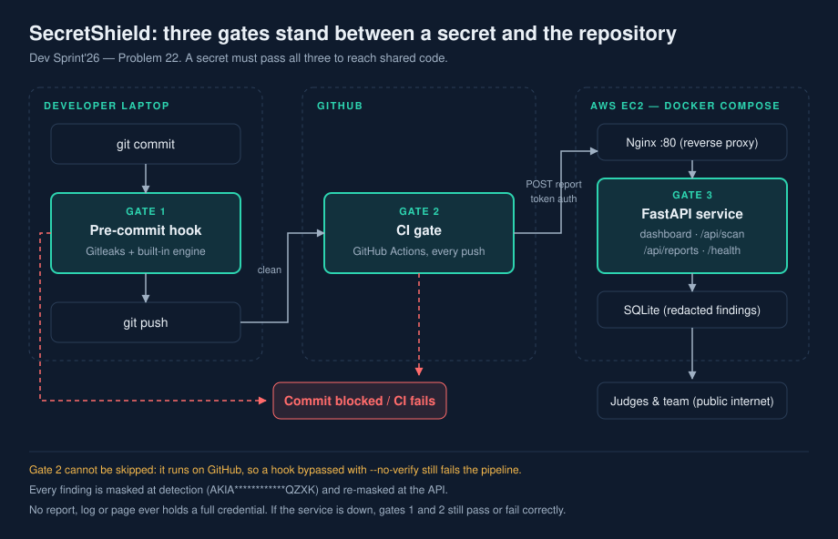

# SecretShield

**Secret-leak detection for Git repositories.** Stops a credential at commit, at push,
and records every scan on a live dashboard.

Dev Sprint'26 — Problem 22, Secret Leak Detection in Git Repositories.

| | |
| --- | --- |
| **Live deployment** | **http://16.112.247.69/** |
| Health check | http://16.112.247.69/health |
| Team | Kavish (lead, DevOps) · Gowshik (backend) · Pranesh (frontend, docs) |

---

## The problem

A developer pastes an API key into the code to make something work, commits it, and
pushes. The key now lives in Git history, where deleting the line later does not help:
every old version is still there, and anyone with repository access can read it.

## The answer: three gates

| | Gate | What it does | Can it be skipped? |
| --- | --- | --- | --- |
| 1 | **Pre-commit hook** | Scans staged files on the laptop; a secret cancels the commit | Yes, with `--no-verify` |
| 2 | **CI gate** | GitHub Actions re-scans every push and fails the pipeline | **No** — it runs on GitHub |
| 3 | **Live service** | Stores the redacted report and shows it on a public dashboard | — |

One missed check is never enough to leak a secret.



---

## Quick start

```bash
git clone https://github.com/<your-username>/secretshield.git
cd secretshield
pip install -r requirements-dev.txt
bash scripts/install-hook.sh        # install the pre-commit hook
pytest -q                            # 36 tests
bash scripts/demo-blocked-commit.sh  # watch a dummy key get blocked
```

Run the service locally:

```bash
export INGEST_TOKEN="sshield_$(python3 -c 'import secrets; print(secrets.token_hex(16))')"
uvicorn app.main:app --reload
# open http://127.0.0.1:8000
```

Deploy it: **[docs/AWS_SETUP.md](docs/AWS_SETUP.md)** has every AWS and GitHub step.

---

## What is in the repository

```
secretshield/
├── app/
│   ├── scanner.py            the detection engine: rules, entropy, redaction
│   ├── main.py               FastAPI service: ingest API, Scan now, dashboard
│   ├── db.py                 SQLite storage
│   └── static/               dashboard UI
├── scripts/
│   ├── secretshield_scan.py  the scan command used by the hook and CI
│   ├── upload_report.py      sends the redacted report to the service
│   ├── install-hook.sh       installs the pre-commit hook
│   ├── demo-blocked-commit.sh  the full demo in a throwaway repo
│   └── deploy-aws.sh         one-shot server setup
├── hooks/pre-commit          the hook itself
├── .github/workflows/secret-scan.yml   the CI gate
├── .gitleaks.toml            scanner rules and the fake-key allowlist
├── fixtures/                 dummy secrets for testing (all fake)
├── tests/                    36 tests
├── docs/                     architecture, AWS guide, test evidence
└── docker-compose.yml        web + nginx
```

---

## How detection works

Two engines run, and their findings are merged:

- **Gitleaks** with our `.gitleaks.toml`, run with `--redact`.
- **A built-in Python engine**, so the gate still works without Gitleaks installed.
  It also powers the Scan now page and the tests.

Nine rules, three severities. **Critical and High block; Low only warns.**

| Rule | Severity |
| --- | --- |
| `aws-access-key`, `aws-secret-key`, `github-token`, `private-key`, `stripe-live-key` | Critical |
| `slack-token`, `secretshield-token`, `generic-api-key` | High |
| `hardcoded-password` | Low |

Four things keep false alarms down: an **entropy threshold** so `"aaaaaaaaaaaa"` is not
a key, **placeholder hints** (`example`, `changeme`, `your_`, `${...}`), a **path
allowlist** for `fixtures/` and `tests/`, and a `# secretshield:allow` line marker for
genuine exceptions.

### What a finding looks like

```
SecretShield SECRET DETECTED

  src/config.py:12
    rule      aws-access-key  (Critical)
    value     AKIA************QZXK
    fix       Delete the key from the code and read it from an environment variable
              (AWS_ACCESS_KEY_ID). Deactivate and rotate the key in AWS IAM. If it
              was pushed, purge it from history with git filter-repo.

  Commit blocked. Remove the secret and commit again.
```

**The value is always masked.** A scanner that prints secrets into its own logs is
itself a leak, so no report, log line or web page in this project ever holds a full
credential. The service re-masks anything a client sends it, and a test proves it.

---

## Safe secret handling

This is how we handle secrets, and what the scanner pushes developers toward.

### Do

- **Read secrets from environment variables.** Never write one in code.
- **Commit `.env.example` with names only**, never values:
  ```bash
  # .env.example
  AWS_ACCESS_KEY_ID=
  DATABASE_URL=
  ```
- **Keep `.env` in `.gitignore`.** It already is in this repo.
- **Use the platform's secret store** for CI. Our own pipeline does this: the ingest
  token reaches GitHub Actions as `secrets.SECRETSHIELD_TOKEN`, never as a file.
- **Use a secrets manager in production** — AWS Secrets Manager or SSM Parameter Store.
- **Rotate on a schedule**, not only after an incident.

### Do not

- Do not commit `.pem`, `.key`, `id_rsa` or a service-account JSON.
- Do not paste a key into an issue, a pull request comment or a chat message.
- Do not assume a private repository is safe: forks, clones and leavers all keep a copy.
- Do not "fix" a leak by deleting the line in a new commit. The old commit still has it.

### If a secret leaks

1. **Rotate it first.** Revoke the old credential at the provider. Nothing else matters
   until this is done — assume it was copied the moment it was pushed.
2. **Remove it from the code**, replacing it with an environment variable.
3. **Purge it from history** if it was already pushed:
   ```bash
   pip install git-filter-repo
   git filter-repo --invert-paths --path path/to/leaked_file
   git push --force --all     # tell your team first; this rewrites history
   ```
4. **Check the provider's audit log** for use you did not expect.
5. **Add a rule** to `.gitleaks.toml` if the pattern was missed.

Rotation is step 1 for a reason. Purging history without rotating leaves a live
credential in every clone that already exists.

---

## The scan command

```bash
python3 scripts/secretshield_scan.py --staged              # what the hook runs
python3 scripts/secretshield_scan.py --all --json report.json   # what CI runs
python3 scripts/secretshield_scan.py --paths src/config.py
python3 scripts/secretshield_scan.py --paths fixtures/ --force  # include allowlisted paths
```

Exit codes: `0` clean or warnings only, `1` a Critical or High finding, `2` usage error.

## The API

| Endpoint | Method | Auth | Purpose |
| --- | --- | --- | --- |
| `/` | GET | — | Dashboard |
| `/health` | GET | — | Health check |
| `/api/reports` | POST | `X-Ingest-Token` | Upload a redacted report (CI) |
| `/api/reports` | GET | — | Scan history |
| `/api/scan` | POST | — | Scan pasted text; nothing is stored |

---

## Tests

```bash
pytest -q        # 39 passed
```

Full results and the eight SRS acceptance tests: **[docs/TEST_EVIDENCE.md](docs/TEST_EVIDENCE.md)**.

## Architecture

Diagrams, data model and rule details: **[docs/ARCHITECTURE.md](docs/ARCHITECTURE.md)**.

## Team

Who does what, the event-day timeline, demo roles and the troubleshooting table:
**[docs/RUNBOOK.md](docs/RUNBOOK.md)**.

---

## Demo script (3 minutes)

1. Show the clean repository and the live dashboard.
2. Add a dummy API key and run `git commit` — the hook blocks it and explains the fix.
3. Bypass with `git commit --no-verify` and push — **CI fails**, and the report appears
   on the dashboard.
4. Replace the key with an environment variable — the commit passes, CI turns green.
5. Hand a judge the Scan now page and let them paste their own fake key.

---

## Limitations

- Pattern-based detection finds known credential shapes. A secret in an unusual format
  can be missed, which is why the three gates are layered rather than trusted alone.
- SecretShield detects and blocks. It does not rotate keys or rewrite history for you;
  it tells you how.
- The deployed demo runs over plain HTTP. For real use, put a certificate on it.
- Dummy credentials in `fixtures/` are fake and match no real account.

## Licence

MIT.
